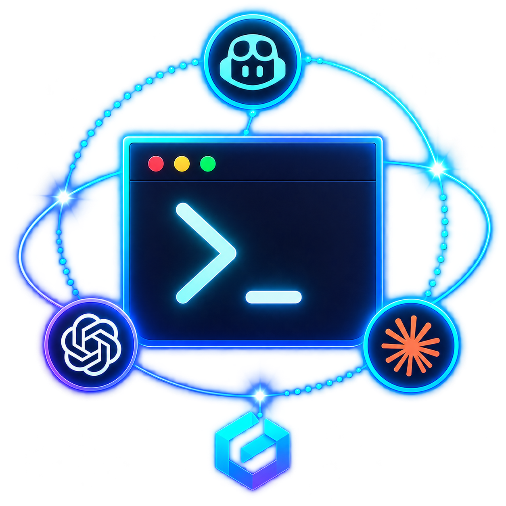

# AgenticCLIKit

[](https://github.com/messeb/AgenticCLIKit/actions/workflows/ci.yml)
[](https://messeb.github.io/AgenticCLIKit/documentation/agenticclikit)
[](https://swift.org)
[](https://developer.apple.com/macos/)
[](LICENSE)

<p align="center">
  
</p>

<p align="center">
  <a href="https://github.com/anthropics/claude-code"></a>
  <a href="https://github.com/openai/codex"></a>
  <a href="https://github.com/github/copilot-cli"></a>
  <a href="https://antigravity.google"></a>
  <a href="https://github.com/mistralai/mistral-vibe"></a>
  <a href="https://x.ai/cli"></a>
</p>

<p align="center"><sub>Supported CLIs — each badge shows the release its adapter is verified against.</sub></p>

A Swift library for driving locally installed agentic CLIs — Claude Code, Codex, GitHub Copilot, Antigravity, Mistral Vibe, and xAI Grok Build — from your own macOS app.

The CLIs bring their own auth, billing, sandboxing, and sessions. This package brings one typed Swift API on top: discovery, runs, streaming, typed results, tool calling, session recovery, and typed errors.

> [!IMPORTANT]
> **Not for sandboxed apps.** App Sandbox cannot spawn user-installed binaries, so Developer ID distribution works and the Mac App Store does not. The package also never installs, updates, or logs into a CLI — it tells you what is missing and which command fixes it. See [App Sandbox and distribution](https://messeb.github.io/AgenticCLIKit/documentation/agenticclikit/sandboxing).

## Installation

macOS 13+, Swift 6.0+, no third-party dependencies.

```swift
// Package.swift
.package(url: "https://github.com/messeb/AgenticCLIKit.git", from: "1.0.0")

// target dependencies
.product(name: "AgenticCLIKit", package: "AgenticCLIKit")
```

The user installs and signs into the CLIs themselves (for example `npm install -g @anthropic-ai/claude-code`, then `claude`).

## Usage

### 1. Check what is ready

```swift
import AgenticCLIKit

let kit = AgenticCLIKit()

let report = await kit.healthReport()
print(report.formattedSummary())
// ✓ Claude Code 2.1.296 — you@example.com via subscription
// ✓ Codex 0.162.1 — authenticated via subscription
// ✗ Grok Build 1.0.50 — not logged in — run `grok login`
```

### 2. Run a prompt

Every run states a permission policy — there is no default, so an agent never edits files unasked.

```swift
let response = try await kit.run(
    "Summarise the uncommitted changes",
    using: .claudeCode,
    configuration: .readOnly(in: repositoryURL)
)

response.text
response.usage?.costUSD
response.session          // keep this to continue later
```

| Policy | Meaning |
|---|---|
| `.planOnly` | Produce a plan, take no action |
| `.readOnly` | Read and search; no writes, no shell |
| `.allowingTools(allowed:denied:)` | Exact tool allowlist (Claude Code, Copilot, Vibe, Grok) |
| `.acceptingEdits` | Edit files in the working directory |
| `.unsafeBypassAll` | Skip every check — the name is the warning |

Each policy maps onto the CLI's own flags; an adapter that cannot honour one throws instead of widening it. → [Permissions](https://messeb.github.io/AgenticCLIKit/documentation/agenticclikit/permissions)

### 3. Continue a conversation

```swift
let followUp = try await kit.resume(response.session!, with: "Now write the tests", configuration: config)
```

Sessions are `Codable` metadata; the transcript stays with the CLI, so they survive relaunches. Give the kit a store and it resumes when it can and starts fresh when the CLI has forgotten:

```swift
let kit = AgenticCLIKit(sessionStore: try FileSessionStore.applicationSupport())
let reply = try await kit.continueOrStart("Keep going", using: .claudeCode, configuration: config)
```

→ [Sessions](https://messeb.github.io/AgenticCLIKit/documentation/agenticclikit/sessions)

### 4. Get a typed result

```swift
struct CommitMessage: StructuredOutput {
    let commitSubject: String
    let commitDescription: String

    static let outputSchema = JSONSchema.object([
        "commitSubject": .string("Imperative mood, at most 50 characters"),
        "commitDescription": .string("Body explaining why the change was made"),
    ])
}

let result = try await kit.run(
    "Write a commit message for the staged changes",
    returning: CommitMessage.self,
    using: .claudeCode,
    configuration: .readOnly(in: repositoryURL)
)
result.value.commitSubject
```

Claude Code, Codex, Antigravity, and Grok enforce the schema in the provider. Copilot and Vibe cannot, and throw `.unsupportedCapability` rather than hoping for JSON. → [Typed results](https://messeb.github.io/AgenticCLIKit/documentation/agenticclikit/typedresults)

### 5. Let the agent call your app's functions

Describe a tool the way Foundation Models does, and the agent can call it mid-conversation — on all six CLIs.

```swift
struct WeatherTool: AgentTool {
    let name = "getWeather"
    let description = "Retrieve the latest weather information for a city"

    struct Arguments: Decodable, Sendable { let city: String }
    struct Forecast: Encodable, Sendable { let city: String; let temperature: Int }

    let argumentSchema = JSONSchema.object([
        "city": .string("The city to get weather information for"),
    ])

    func call(arguments: Arguments) async throws -> Forecast {
        Forecast(city: arguments.city, temperature: try await Weather.temperature(in: arguments.city))
    }
}

let session = AgentSession(
    cli: .claudeCode,
    workingDirectory: repositoryURL,
    tools: [WeatherTool()],
    instructions: "Help the person with getting weather information"
)

let answer = try await session.respond(to: "Is it hotter in Boston, Wichita, or Pittsburgh?")
answer.text                    // "Wichita is hottest at 94°F…"
answer.toolCalls.map(\.tool)   // ["getWeather", "getWeather", "getWeather"]
answer.usage?.costUSD          // summed across every round

let more = try await session.respond(to: "And which was coldest?")   // same conversation
```

How it works: each turn the agent replies with one JSON object — a tool call or a final answer. The session runs the tool, resumes the CLI conversation with the result, and repeats. No MCP server, socket, or entitlement is involved.

- A tool that throws, or a tool name that does not exist, goes back to the agent as an error result it can react to; it shows up in `toolCalls` with `isError == true`.
- `maximumToolRounds` (default 8) bounds the loop; exceeding it throws `.toolCallLimitReached`.
- Each tool call costs one CLI round trip.
- `NoArguments` is for tools without parameters; `AgentFunction` takes raw JSON instead of typed arguments.
- One-shot form: `kit.run(prompt, tools: [WeatherTool()], using: .codex, configuration: config)`.

→ [Tool calling](https://messeb.github.io/AgenticCLIKit/documentation/agenticclikit/toolcalling)

### 6. Stream events

```swift
for try await event in kit.stream("Review this diff", using: .claudeCode, configuration: config) {
    switch event {
    case .sessionStarted(let session):  store(session)
    case .assistantTextDelta(let text): transcript += text
    case .toolUseRequested(let tool):   show(tool.name)
    case .finished(let response):       complete(response)
    case .raw(let json):                log(json)   // anything not modelled
    default: break
    }
}
```

To stop a run, cancel the `Task`; the whole process tree is terminated.

### 7. Attach files, data, or URLs

```swift
var config = RunConfiguration.readOnly(in: workingDirectory)
config.attachments = [
    .file(invoiceURL, description: "the invoice to summarise"),
    .remote(URL(string: "https://example.com/spec.pdf")!),
    .data(screenshotPNG, filename: "screen.png"),
]
```

URLs are downloaded by the kit, data goes to a per-run scratch directory, and everything is checked before the CLI starts. → [Attachments](https://messeb.github.io/AgenticCLIKit/documentation/agenticclikit/attachments)

### 8. Pick a model

```swift
let models = try await kit.availableModels(for: .antigravity)
config.model = models.defaultModel?.id      // or any string, e.g. "claude-opus-6"
```

Leave `model` as `nil` and the user's own CLI default is used. → [Models](https://messeb.github.io/AgenticCLIKit/documentation/agenticclikit/models)

### 9. Handle errors

```swift
do {
    try await kit.run(prompt, using: .codex, configuration: config)
} catch let error as AgenticCLIError {
    switch error {
    case .notInstalled(_, let hint):         showInstallSheet(hint)
    case .notAuthenticated(_, let command):  showSignInButton(runs: command)
    case .unsupportedCapability:             disableFeature()
    case .sessionNotFound:                   startFresh()
    default:                                 report(error)
    }
}
```

Every error has a `localizedDescription` and, where possible, a `recoverySuggestion` you can show.

## Supported CLIs

| | Claude Code | Codex | Copilot | Antigravity | Vibe | Grok Build |
|---|---|---|---|---|---|---|
| Executable | `claude` | `codex` | `copilot` | `agy` | `vibe` | `grok` |
| Verified against | 2.1.296 | 0.162.1 | 1.0.95 | 1.3.2 | 2.26.1 | 1.0.50 |
| Sessions / resume | ✅ | ✅ | ✅ | ✅ same directory | ✅ | ✅ |
| Token streaming | ✅ | whole messages | ✅ | ✅ | whole messages | ✅ |
| Schema-enforced output | ✅ | ✅ | ❌ | ✅ | ❌ | ✅ |
| Tool calling | ✅ | ✅ | ✅ prompted | ✅ | ✅ prompted | ✅ |
| Per-tool allowlist | ✅ | ❌ | ✅ | ❌ | ✅ | ✅ |
| Usage | tokens + USD | tokens | premium requests | tokens | tokens + USD | tokens |
| Attachments | ✅ | ✅ + images | ✅ + images | ✅ | ✅ | ❌ |
| Turn limits | ❌ | ❌ | ❌ | ❌ | ✅ | ✅ |
| Status | stable | stable | stable | experimental | experimental | experimental |

Capabilities are declared, not assumed: asking for something an adapter cannot do faithfully throws `.unsupportedCapability`. GitHub's agent is `copilot`, not `gh`.

## Demo CLI

```bash
swift run agentickit health
swift run agentickit run claude-code "What does this package do?" --permissions readOnly --stream
swift run agentickit continue codex "Keep going"
swift run agentickit tools grok "Is it hotter in Boston, Wichita, or Pittsburgh?"
swift run agentickit models
swift run agentickit sessions
```

## How it behaves

- **Finds CLIs like a terminal does.** Apps launched from Finder have a minimal `PATH`, so discovery also checks common install directories and asks the login shell.
- **Passes only the environment each CLI needs.** Your app's secrets are not inherited; each adapter opts into its own credential variables.
- **Never leaves stdin open**, so no CLI can hang waiting for input.
- **Never logs prompts** unless you enable `Log.isPromptLoggingEnabled`.

## Known limits

- **CLIs change often.** Adapters check versions and fail with typed errors rather than pass unknown flags; `rawOutput` is the escape hatch.
- **Antigravity** cannot resume a session from a different directory, and before 1.3 it cannot stream or use plan mode with a schema.
- **Vibe** reports usage from its session store after the process exits; with session logging off, `usage` is `nil`. Before 2.26 it cannot do tool calling under `.planOnly` or `.readOnly`.
- **Copilot** models must be enabled per account before `--model` accepts them; `auto` always works.

## Testing

Adapters are tested against transcripts recorded from the real CLIs. The `AgenticCLIKitTesting` product gives your own tests the same tools (`RecordedProcessRunner`, `StubAgent`, `ScriptedAgent`).

```bash
swift test                                # unit tests, no CLIs needed
AGENTICCLIKIT_INTEGRATION=1 swift test    # + real discovery and auth probes (free)
AGENTICCLIKIT_LIVE=1 swift test           # + real agent turns (spends tokens)
```

## Documentation

- [API documentation](https://messeb.github.io/AgenticCLIKit/documentation/agenticclikit) and [Getting started](https://messeb.github.io/AgenticCLIKit/documentation/agenticclikit/gettingstarted)
- [Permissions](https://messeb.github.io/AgenticCLIKit/documentation/agenticclikit/permissions) · [Typed results](https://messeb.github.io/AgenticCLIKit/documentation/agenticclikit/typedresults) · [Tool calling](https://messeb.github.io/AgenticCLIKit/documentation/agenticclikit/toolcalling) · [Attachments](https://messeb.github.io/AgenticCLIKit/documentation/agenticclikit/attachments) · [Sessions](https://messeb.github.io/AgenticCLIKit/documentation/agenticclikit/sessions) · [Models](https://messeb.github.io/AgenticCLIKit/documentation/agenticclikit/models)
- [Writing an adapter](https://messeb.github.io/AgenticCLIKit/documentation/agenticclikit/writinganadapter) · [App Sandbox and distribution](https://messeb.github.io/AgenticCLIKit/documentation/agenticclikit/sandboxing)

## Contributing

Issues and pull requests are welcome — see [CONTRIBUTING.md](CONTRIBUTING.md). Adapter changes must be verified against the real CLI, and fixtures are recorded, never hand-written.

[Code of Conduct](CODE_OF_CONDUCT.md) · [Security](SECURITY.md) · [Support](SUPPORT.md) · [Changelog](CHANGELOG.md) · [Releasing](docs/RELEASING.md)

## License

MIT — see [LICENSE](LICENSE).
